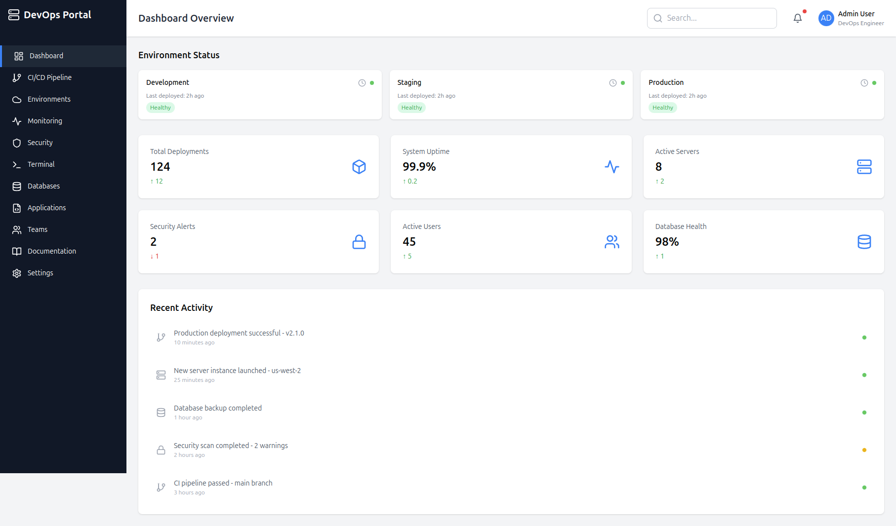

# DevOps Portal

The DevOps Portal is a web-based platform designed to provide an overview of your environment's health and recent activity. It allows DevOps engineers to monitor and manage deployment pipelines, system performance, and security alerts across different environments (Development, Staging, Production). The dashboard provides real-time insights into key system metrics, enabling users to make data-driven decisions.

## Features

- **Environment Overview**: View the health status of different environments (Development, Staging, and Production) along with deployment status and system uptime.
- **Deployment Tracking**: Track the number of deployments and recent deployment details, including the version deployed and the time.
- **System Metrics**: Monitor key system metrics like uptime, active servers, and database health.
- **Security Alerts**: View and manage security alerts for your environments.
- **Recent Activity Feed**: Stay updated with the most recent actions such as deployments, server launches, and database backups.
- **CI/CD Pipeline**: View the status of your continuous integration and continuous deployment pipelines.

## Technologies

- **Frontend**:
  - React.js
  - Tailwind CSS for styling
  - Vite for fast builds
- **Backend**:
  - Node.js (if applicable for backend services)
  - REST API (for fetching real-time system data)
- **Others**:
  - Docker (optional, if containerization is used)
  - AWS or Azure (if cloud-based infrastructure is used)

## Installation

To run the project locally, follow these steps:

1. Clone the repository:
   ```bash
   git clone <repository-url>
   ```

2. Navigate to the project directory:
   ```bash
   cd devops-portal
   ```

3. Install dependencies:
   ```bash
   npm install
   ```

4. Start the development server:
   ```bash
   npm run dev
   ```

The application will be accessible at `http://localhost:3000`.

## Configuration

- **Environment Variables**: Set any necessary environment variables in the `.env` file, especially for API keys and cloud credentials.
- **Vite Configuration**: Make sure to adjust Vite's configuration for production builds if necessary.

## Screenshots

 

## Features Breakdown

### Environment Status
View the health and deployment status of your environments (Development, Staging, and Production), including uptime, active servers, and database health.

### Recent Activity
Stay up to date with recent actions such as:
- **Deployments**: View successful deployments, version changes, and pipeline progress.
- **Server and Database Actions**: Track server launches, backups, and security scans.

### Security Alerts
Monitor and act upon any security alerts related to your infrastructure to ensure the integrity of your systems.

## Contributing

If you'd like to contribute to the development of the DevOps Portal, feel free to fork the repository and create pull requests with bug fixes, new features, or enhancements.

## License

Distributed under the MIT License. See `LICENSE` for more information.

## Developer

- **Developer**: Ismail MOUYAHADA

## Footer

```
© 2023 DevOps Portal. All rights reserved.
```
 

## Deploy

[](https://vercel.com/new/clone?repository-url=https%3A%2F%2Fgithub.com%2Fghostland-dev%2Fdevops-portal)

Click the button to deploy your own copy on Vercel in one step.
